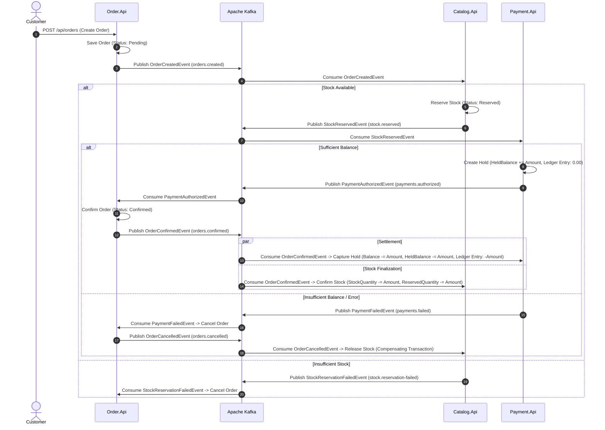

# Marketlite

Distributed event-driven e-commerce and fintech marketplace built with **.NET 10**, **PostgreSQL**, and **Apache Kafka**.

---

## 1. Architecture Overview

Marketlite is structured around bounded contexts conforming to Domain-Driven Design (DDD) principles:

* **Payment.Api (Fintech Core)**: User accounts, two-phase payment authorization (Hold/Capture/Release), double-entry style audit ledger, and strict concurrency protection via PostgreSQL `xmin`.
* **Catalog.Api (Warehouse & Inventory)**: Product catalog, dynamic available stock calculation, and atomic multi-item stock reservation with duplicate item consolidation.
* **Order.Api (Saga Initiator)**: Order lifecycle management, status state machine (Pending, Confirmed, Cancelled), and Kafka event publishing.
* **Shared.Contracts**: Inter-service event contracts (`OrderCreatedEvent`, `StockReservedEvent`, `PaymentAuthorizedEvent`, etc.) and lightweight Kafka producer abstraction.

---

## 2. Distributed Saga Workflow



---

## 3. Financial Guarantees & Concurrency Control

* **Double-Entry Ledger Reconciliation**: Real balance changes occur strictly upon `Deposit` (+Amount) and `HoldCaptured` (-Amount). Holds and releases record audit entries with 0.00 balance delta. Mathematical guarantee: $\sum \text{LedgerEntries.Amount} == \text{Account.Balance}$.
* **Optimistic Concurrency Control**: Entity versions are tracked via PostgreSQL system column `xmin` (`.IsRowVersion()`). Under high contention, services execute up to 3 automatic retries with fresh database state reloading before rejecting requests.
* **Real PostgreSQL Verification (Testcontainers)**: Concurrency guarantees are verified via automated integration tests spinning up dynamic PostgreSQL 16 containers in Docker, simulating 10 concurrent hold requests on a 3-unit balance.
* **Strict Idempotency**: All hold and reservation requests require unique keys. Re-executing an existing key with identical payload returns the prior record; re-executing with conflicting amounts returns `409 Conflict`.
* **Sub-Cent Rejection**: Fractional cents (e.g., $0.001) are strictly rejected with `422 Unprocessable Entity`.
* **Audit Protection**: Cascade deletion of `TransactionLedger` is disabled via `DeleteBehavior.Restrict`.

---

## 4. Getting Started

### Prerequisites
* [.NET 10 SDK](https://dotnet.microsoft.com/download)
* [Docker Desktop](https://www.docker.com/products/docker-desktop/)

### 1. Start Infrastructure
```bash
docker compose up -d
```
This spins up PostgreSQL 16 (port 5432) with pre-initialized databases (`market_payments`, `market_catalog`, `market_orders`) and Apache Kafka (port 9092, KRaft mode).

### 2. Apply EF Core Migrations
```bash
dotnet ef database update --project src/Payment.Api/Payment.Api.csproj --startup-project src/Payment.Api/Payment.Api.csproj
dotnet ef database update --project src/Catalog.Api/Catalog.Api.csproj --startup-project src/Catalog.Api/Catalog.Api.csproj
dotnet ef database update --project src/Order.Api/Order.Api.csproj --startup-project src/Order.Api/Order.Api.csproj
```

### 3. Run Test Suite
```bash
dotnet test
```
All unit and Testcontainers integration tests will execute.

### 4. Run Services
```bash
dotnet run --project src/Order.Api/Order.Api.csproj
dotnet run --project src/Payment.Api/Payment.Api.csproj
dotnet run --project src/Catalog.Api/Catalog.Api.csproj
```
